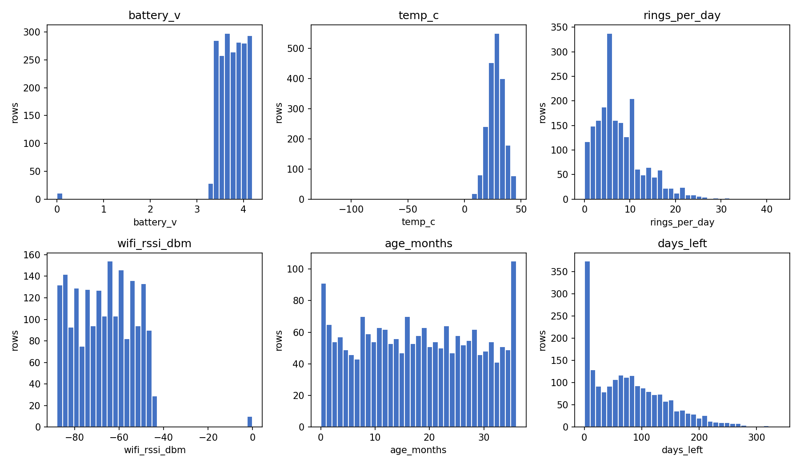
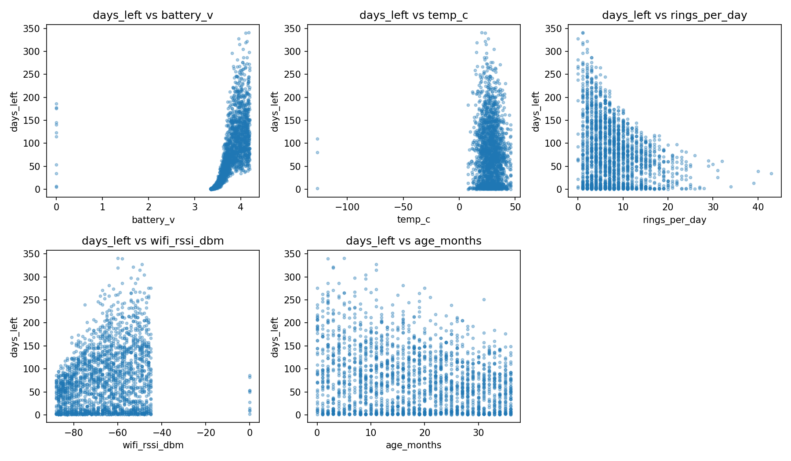
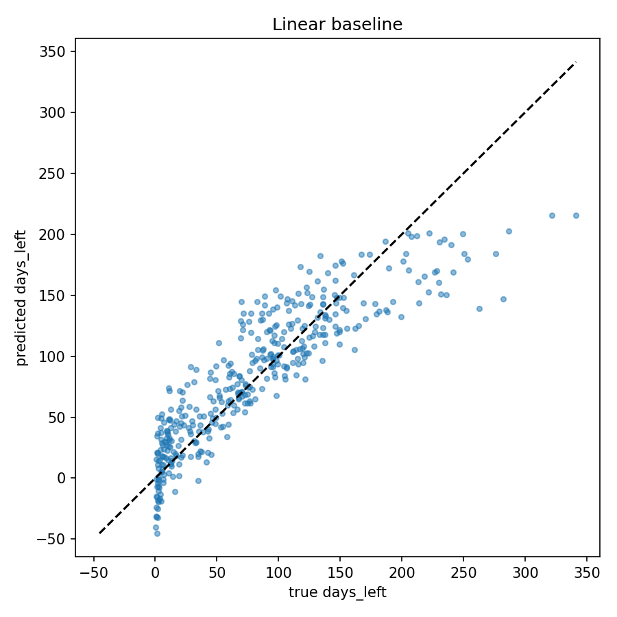
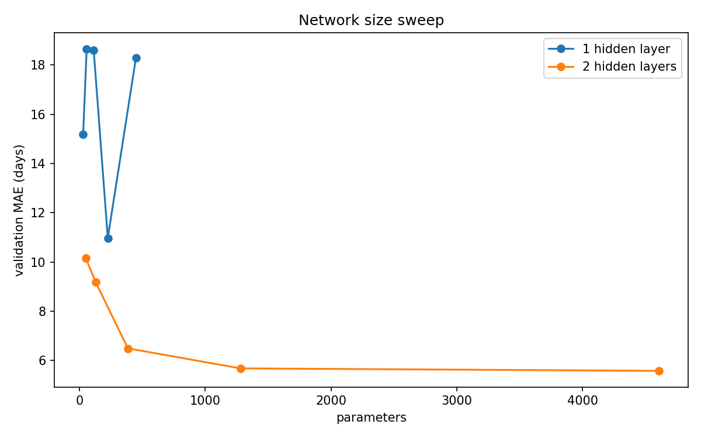
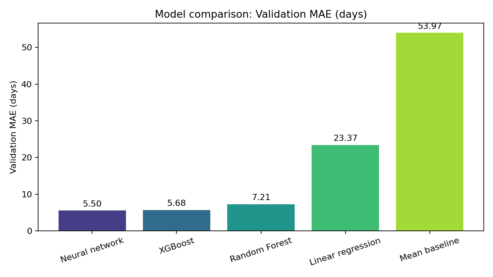
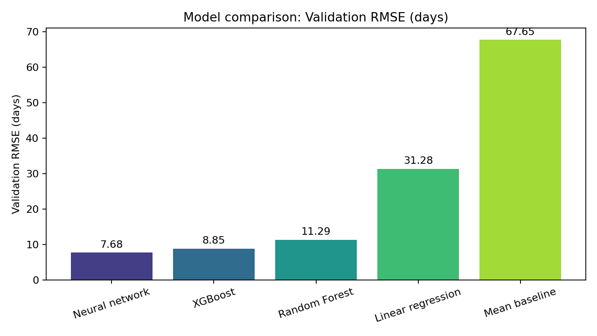
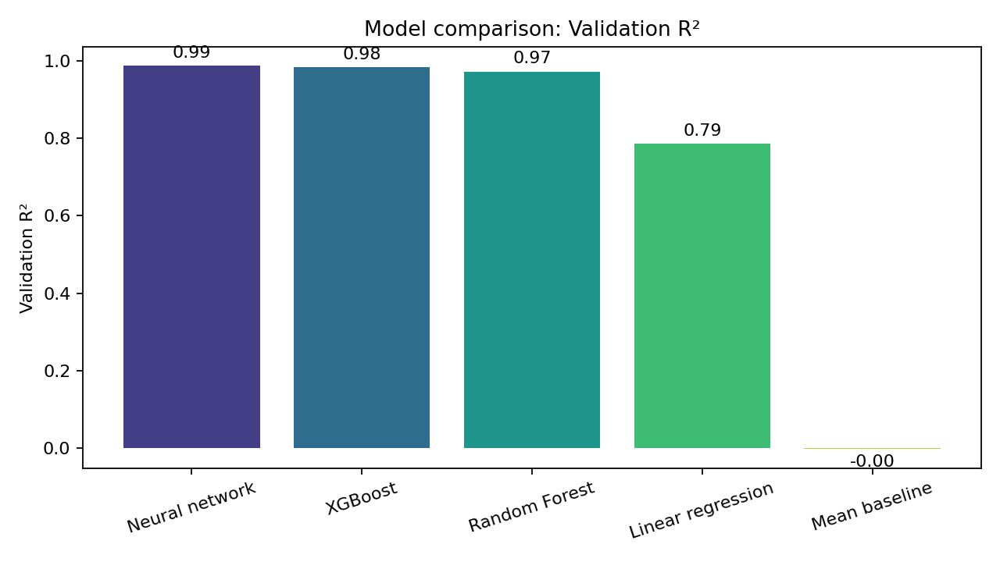
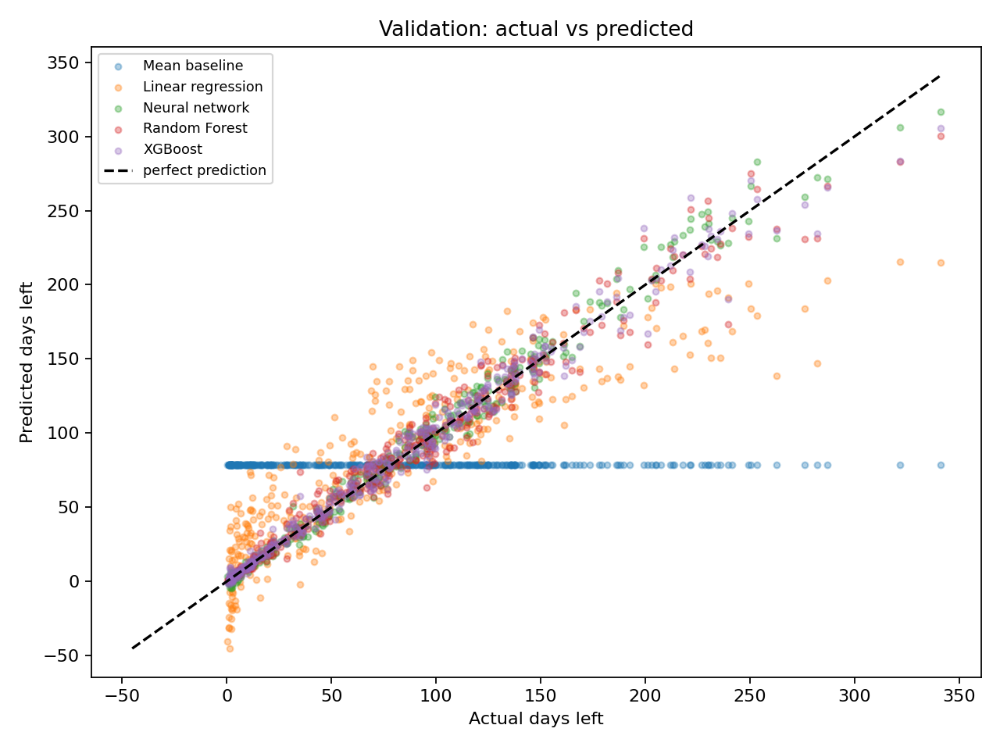
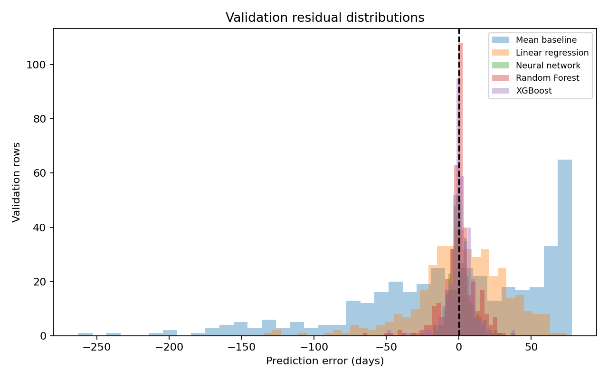

# Battery Life Prediction using Edge AI

**AI255TBD Edge AI · Module 1 · Team 28**
**Date:** 22 November 2026

## Abstract

This project predicts doorbell battery life in days from voltage, temperature, ring frequency, Wi-Fi signal strength, and device age. The 2,000-row supplied team-28 dataset was cleaned using broad sensor-validity rules, split deterministically into training and validation rows, and used to compare five regressors. The best validation result was a two-hidden-layer PyTorch network with 32 units per layer: 5.499 days MAE, 7.679 days RMSE, and R² of 0.987 on 395 validation readings. A FastAPI service exposes the prediction and model metadata, while a Streamlit dashboard calls that service for interactive and CSV batch predictions. The selected network has 1,281 parameters and an FP32 weight footprint of 5,124 bytes, making its weight storage compatible with the assignment's SRAM budget. Board latency and INT8 performance remain estimates until measured on actual hardware.

## 1. Problem Statement

A low-battery warning is not actionable enough for maintenance planning. The task is to estimate how many days remain using operational readings from a doorbell. The output is a regression estimate, not a guarantee: a real deployment must validate it against future devices and measured battery discharge.

## 2. Objectives

- Inspect the supplied data and identify impossible sensor records.
- Establish mean and linear-regression baselines.
- Train and size small neural-network variants without validation leakage.
- Compare the MLP with Random Forest and XGBoost under the same split.
- Serve predictions with input validation, stage timing, and model metadata.
- Provide an interactive dashboard and batch-CSV workflow.
- Evaluate memory feasibility and document measured values separately from estimates.

## 3. Dataset Description

The source is the supplied `data/team_28_train.csv`; no external observations were added. It contains 2,000 rows, five sensor features, and one target. The original columns contain no missing values.

| Column | Meaning | CSV type | Raw observed range |
|---|---|---|---:|
| `battery_v` | Battery voltage in volts | float64 | 0.000 to 4.199 |
| `temp_c` | Temperature in Celsius | float64 | -127.000 to 46.000 |
| `rings_per_day` | Doorbell rings per day | int64 | 0 to 43 |
| `wifi_rssi_dbm` | Received Wi-Fi signal in dBm | int64 | -88 to 0 |
| `age_months` | Device age in months | int64 | 0 to 36 |
| `days_left` | Remaining battery life in days; prediction target | float64 | 0.4 to 341.2 |

The input ranges above are observed sample extrema, not serving limits.

## 4. Exploratory Data Analysis

The histogram and scatter plots below were generated from the actual CSV. Scatter plots show raw values, including the sensor sentinels subsequently removed.





The cleaned-data Pearson correlations with `days_left` were: battery voltage 0.750, temperature -0.061, rings per day -0.278, Wi-Fi RSSI 0.277, and age -0.243. Correlation is only a linear summary. The rings-per-day plot has a curved, decreasing envelope: heavier use is associated with fewer days, but the effect is not a single straight line. Battery voltage shows a rising, curved relationship with substantial spread. Wi-Fi signal and age have weaker, noisier relationships; temperature has little linear correlation in this sample. Interactions and the broad spread motivate comparing nonlinear models.

The raw plots visibly expose the 0 V, -127 °C, and 0 dBm records. These are not treated as ordinary statistical outliers: each violates an operational sensor constraint.

## 5. Data Cleaning and Preprocessing

Training cleanup uses broad physical plausibility limits:

| Field | Training cleaning rule | Rows flagged |
|---|---:|---:|
| `battery_v` | finite and 2.0 to 4.5 V | 11 |
| `temp_c` | finite and -40 to 85 °C | 3 |
| `rings_per_day` | finite and 0 to 1,000 | 0 |
| `wifi_rssi_dbm` | finite and -110 to -1 dBm | 10 |
| `age_months` | finite and 0 to 600 months | 0 |
| `days_left` | finite and non-negative | 0 |

There were no overlapping flags in this CSV: 24 of 2,000 rows were removed, leaving 1,976. The API separately restricts prediction inputs to the cleaned dataset's observed feature ranges: battery voltage 3.35–4.20 V, temperature 8–46 °C, rings per day 0–43, Wi-Fi RSSI -88 to -45 dBm, and device age 0–36 months. Requests outside these ranges receive HTTP 422 responses.

The row indices are shuffled with `numpy.random.default_rng(0)`. The first 395 shuffled rows form validation data; the remaining 1,581 are training data. The MLP's mean and standard deviation are computed from training inputs only:

| Feature | Training mean | Training standard deviation |
|---|---:|---:|
| `battery_v` | 3.77644 | 0.24637 |
| `temp_c` | 28.16059 | 7.11237 |
| `rings_per_day` | 7.96964 | 5.46824 |
| `wifi_rssi_dbm` | -66.65338 | 12.54160 |
| `age_months` | 17.90512 | 10.43748 |

The same stored values transform validation and serving inputs. The mean and standard deviation are never fit on validation rows.

## 6. Baseline Models

The mean baseline predicts the training-target mean for every validation row. Its validation MAE is **53.972 days**, RMSE **67.647 days**, and R² **-0.002**.

The linear baseline solves a least-squares system containing the five raw features and a constant intercept column using `numpy.linalg.lstsq`. Its validation MAE is **23.366 days**, RMSE **31.281 days**, and R² **0.786**. Its largest absolute validation error was 134.81 days (row index 982: actual 282.00, predicted 147.19), illustrating the limits of a straight-line model on curved relationships.



## 7. Neural Network Development

The shared PyTorch model maps five inputs through configurable hidden layers with ReLU activations to one scalar output. The selected layout is **5 -> 32 -> 32 -> 1**. Training uses Adam at learning rate 0.003, mean-squared-error loss, mini-batches of 128, seed 0, and 1,500 epochs. The prediction is clipped to non-negative days when served.

At 1,500 epochs, training MAE was **4.386 days** and validation MAE **5.499 days**. The 1.113-day gap indicates modest generalization error, not zero overfitting. A comparison run with normalization disabled had training MAE 16.46 and validation MAE 16.84 days.

The architecture sweep trains widths 4, 8, 16, 32, and 64 with one or two hidden layers for 600 epochs each:

| Hidden widths | Parameters | Training MAE | Validation MAE |
|---|---:|---:|---:|
| 4 | 29 | 15.562 | 15.178 |
| 8 | 57 | 17.892 | 18.655 |
| 16 | 113 | 17.837 | 18.589 |
| 32 | 225 | 10.802 | 10.974 |
| 64 | 449 | 17.569 | 18.292 |
| 4, 4 | 49 | 10.209 | 10.167 |
| 8, 8 | 129 | 8.810 | 9.179 |
| 16, 16 | 385 | 5.581 | 6.496 |
| 32, 32 | 1,281 | 4.595 | 5.685 |
| 64, 64 | 4,609 | 4.175 | 5.585 |

The 64-by-64 model improved the 600-epoch validation result by only 0.10 days while using 3.6 times as many parameters. The 32-by-32 model was selected for its near-best error, smaller size, and simplest deployed path. The final model was then trained for 1,500 epochs and measured separately at 5.499 days validation MAE.



## 8. Random Forest

A Random Forest averages predictions from decision trees trained on bootstrap samples and feature subsets. It was included as a nonlinear, scale-insensitive tabular baseline. A validation-MAE search covered 100/300 trees, unlimited/12-level depth, and leaf sizes 1/2, with a fixed seed and one CPU worker.

The selected configuration used 300 trees, maximum depth 12, and minimum leaf size 1. Its validation MAE was **7.212 days**, RMSE **11.285 days**, and R² **0.972**. The selected fit took **1.947 seconds**; all candidate fits together took **9.475 seconds**. Its serialized joblib artifact is **35,007,857 bytes**, much larger than the MLP, and its measured one-row prediction path was 40.838 ms on the local environment.

## 9. XGBoost

XGBoost builds trees sequentially, with later trees correcting residual errors from earlier trees. It was installed successfully as XGBoost 3.4.1 and evaluated with squared-error regression and histogram tree construction. The search compared 200/500 trees and depths 3/5 using a fixed seed, learning rate 0.05, 0.9 row/column sampling, and L2 regularization of 1.

The selected configuration used 200 trees and depth 5. Its validation MAE was **5.675 days**, RMSE **8.849 days**, and R² **0.983**. The selected fit took **0.174 seconds**; the four candidate fits took **0.977 seconds** total. Its serialized JSON model is **654,500 bytes**; the measured one-row prediction path was 0.499 ms locally.

## 10. Complete Model Comparison

All validation metrics use the same cleaned validation rows and target. Model inference latency is the mean duration of 500 warmed-up, single-row prediction calls; it is local software timing and not an ESP32 measurement. The MLP path includes input standardization. Serialized file size is not the same as SRAM inference memory.

| Model | MAE (days) | RMSE (days) | R² | Selected-fit time (s) | Single-row prediction (ms) | Serialized file (bytes) |
|---|---:|---:|---:|---:|---:|---:|
| Neural network | 5.498982 | 7.679408 | 0.987090 | 33.930000 | 0.155011 | 7,869 |
| XGBoost | 5.675091 | 8.849468 | 0.982856 | 0.173934 | 0.498764 | 654,500 |
| Random Forest | 7.211906 | 11.285084 | 0.972120 | 1.946975 | 40.837681 | 35,007,857 |
| Linear regression | 23.365921 | 31.281148 | 0.785786 | 0.000405 | 0.009816 | 302 |
| Mean baseline | 53.972000 | 67.647477 | -0.001809 | 0.000089 | 0.002072 | 21 |

Validation MAE selects the deployed MLP, but predictive performance is not the only deployment criterion. The MLP has a dramatically smaller artifact and parameter footprint than the tree ensembles, and XGBoost is close in validation MAE. The reported validation score was also used for model selection and should not be read as an independent test estimate. No hidden 400-reading labels were available locally.











## 11. API Implementation

FastAPI loads the committed network state and configuration when `app.main` starts. Pydantic validates all five finite numeric features against the physical ranges. Invalid requests receive HTTP 422 with field-level details. Valid responses preserve the assignment's JSON shapes.

- `GET /health` reports `status`, team, parameter count, and validation MAE.
- `GET /model_info` derives the linear-layer dimensions, parameter counts, FP32 bytes, MACs, totals, int8 size estimate, and 300 KiB SRAM-fit flags from the instantiated network.
- `POST /predict` accepts one sensor object.
- `POST /predict_batch` accepts `{"rows": [reading, ...]}` and returns ordered predictions.

Real request used for the example:

```json
{
  "battery_v": 3.86,
  "temp_c": 28.0,
  "rings_per_day": 5,
  "wifi_rssi_dbm": -66,
  "age_months": 22
}
```

Captured local response:

```json
{
  "days_left": 136.93,
  "timings_ms": {
    "parse": 4.164,
    "normalise": 1.154,
    "inference": 10.34,
    "build": 0.332,
    "server_total": 16.338
  }
}
```

`/model_info` reports `linear1` (5 to 32: 192 parameters, 768 FP32 bytes, 160 MACs), `linear2` (32 to 32: 1,056 parameters, 4,224 bytes, 1,024 MACs), and `linear3` (32 to 1: 33 parameters, 132 bytes, 32 MACs). Totals are 1,281 parameters, 5,124 FP32 bytes, 1,281 estimated INT8 bytes, and 1,216 MACs.

## 12. Frontend Implementation

`dashboard.py` is a dark-themed Streamlit application using Plotly. Its sidebar provides page navigation and a configurable FastAPI base URL. Prediction forms submit to the existing `/predict` API and display remaining days, sensor values, and returned timings. The model pages call `/health` and `/model_info`; comparison and dataset pages read the generated artifacts and actual CSV.

CSV uploads are checked for required fields and numeric finite values. Fully valid chunks use `/predict_batch`. If a chunk receives HTTP 422, the dashboard retries rows individually so it can retain valid predictions and show an explicit error on each invalid row. Backend outages are reported without issuing a large series of retries. The results can be downloaded as a CSV.

## 13. Edge AI Analysis

For a linear layer, parameters equal `in_features * out_features + out_features`; MACs equal `in_features * out_features`. FP32 size is four bytes per parameter. The INT8 column below is an estimate using one byte per weight and bias; it is not a converted model.

| Width `w` in 5 -> w -> w -> 1 | Parameters | FP32 bytes | INT8 estimated bytes | SRAM fit FP32 / INT8 | 8 MiB PSRAM fit FP32 / INT8 | MACs |
|---:|---:|---:|---:|---|---|---:|
| 32 | 1,281 | 5,124 | 1,281 | Yes / Yes | Yes / Yes | 1,216 |
| 128 | 17,409 | 69,636 | 17,409 | Yes / Yes | Yes / Yes | 17,152 |
| 256 | 67,585 | 270,340 | 67,585 | Yes / Yes | Yes / Yes | 67,072 |
| 512 | 266,241 | 1,064,964 | 266,241 | No / Yes | Yes / Yes | 265,216 |
| 2,048 | 4,210,689 | 16,842,756 | 4,210,689 | No / No | No / Yes | 4,206,592 |

The budget uses 300 KiB = 307,200 bytes. For equal hidden widths, total parameters are `w² + 8w + 1`; the largest width fitting the weight-only SRAM budget is **273 at FP32** (width 274 requires 309,076 bytes) and **550 at INT8** (width 551 requires 308,010 bytes). The deployed model's largest hidden vector is 32 FP32 values or 128 bytes; two simultaneously live hidden buffers would require 256 bytes. INT8 activation values would be 32 bytes per hidden vector if a quantized runtime were used.

The [Espressif ESP32-S3 product specification](https://www.espressif.com/en/products/socs/esp32-s3) states a maximum 240 MHz clock. At an explicit idealized assumption of one MAC per cycle, 1,216 MACs / 240 million MACs per second = **5.07 microseconds** of compute. This excludes instruction scheduling, memory transfers, framework overhead, and quantization costs; it is not measured board latency.

**Deployment trade-off:** this small model can plausibly run locally, which avoids sending sensor readings over Wi-Fi and continues to work when connectivity is unavailable. A server simplifies model updates and centralized monitoring, but adds network latency, data-transfer/privacy considerations, hosting cost, and a connectivity dependency. An on-device implementation still needs target firmware, power, and latency measurements. Given the small MLP and offline/privacy benefits, local inference is a strong candidate, not yet a hardware-verified result.

## 14. Performance Analysis

The API client benchmark was run on the local machine against local Uvicorn, not across a Codespace internet connection. In the 200-request keep-alive run, the first round trip was **16.8 ms**. Subsequent round-trip p50/p95/p99 were **2.433 / 2.893 / 3.260 ms**. Stage p50s were parse 0.046 ms, normalize 0.034 ms, inference 0.222 ms, build 0.021 ms, and server total 0.340 ms; the remaining network/framework component was 2.081 ms.

With `--no-keepalive`, the first round trip was 16.0 ms; subsequent p50/p95/p99 were **3.581 / 18.852 / 26.767 ms**. The median server total was 0.399 ms, with 3.168 ms attributed to network/framework time. New connections increase transport overhead and tail variability.

For 400 local readings, 400 individual `/predict` calls took **1,031.49 ms** total; one `/predict_batch` request took **7.23 ms**. Batching avoids repeated HTTP and parsing overhead and executes the rows in one model call. These measurements are environment-specific; laptop-to-Codespace measurements must be repeated after Codespaces deployment.

Before benchmarking, the prediction was that network/framework overhead would exceed the small model's inference time. The local measurements support that prediction: median network/framework time exceeded median server time in the keep-alive run.

## 15. Results and Discussion

The MLP achieved the best validation MAE (5.499 days), with XGBoost close behind (5.675 days). Random Forest was accurate but produced a roughly 35 MB serialized model and had substantially slower measured single-row prediction in this Python environment. The linear baseline captured broad trends but missed nonlinear effects; the constant baseline did not explain variation. The compact MLP is the best balance among measured validation accuracy, serialized artifact size, and edge feasibility for this assignment.

Validation is a single deterministic split; tuning candidates against it can bias the chosen score optimistically. The hidden company readings, actual ESP32 inference, battery measurement error, and power use were not available. Sensor ranges are engineering assumptions and need confirmation against device specifications.

## 16. Conclusion

The delivered system includes a cleaned-data training pipeline, leakage-aware baselines and MLP, a same-split tree-model comparison, the required FastAPI contract, a Streamlit/Plotly dashboard, CSV batch handling, and an edge-memory analysis. The deployed network gives 5.499 days validation MAE and uses 5,124 FP32 weight bytes. Local API, batch, and dashboard workflows are tested, while Codespace network timing and on-board performance remain future measurements.

## 17. Future Work

- Validate the model on the instructor's 400 unseen readings and on later real-device logs.
- Use repeated splits or cross-validation and tune hyperparameters without reusing a final test set.
- Calibrate an INT8 model and measure accuracy, memory, latency, and power on ESP32-S3 hardware.
- Confirm sensor-operating limits against the exact voltage, temperature, and Wi-Fi sensor hardware.
- Add drift monitoring, model/version tracking, and retraining criteria.
- Measure remote Codespace latency with keep-alive and without keep-alive during the evaluation window.

## 18. Reproducibility and Setup

Use Python 3.11 or newer and run commands from the repository root:

```bash
python -m pip install -r requirements.txt
python train.py --team 28 --hidden 32,32 --epochs 1500 --plots-dir mission_outputs
python evaluate_models.py
python -m unittest discover -s tests -v
uvicorn app.main:app --host 0.0.0.0 --port 8000
streamlit run dashboard.py --server.address 0.0.0.0 --server.port 8501
python docs/build_report.py
```

`train.py` writes the final model files to `model/`. `evaluate_models.py` writes metrics, validation predictions, serialized candidate models, and comparison plots to `model_comparison/`. `python train.py --team 28 --sweep --epochs 600 --plots-dir mission_outputs` reproduces the one/two-hidden-layer width sweep.

## 19. GitHub Codespaces Deployment

The `.devcontainer` installs the requirements and forwards ports 8000 and 8501. Create a Codespace on the repository's `main` branch, then run the backend and dashboard commands above in separate terminal sessions. Make port 8501 Public for the dashboard. Make port 8000 Public if external graders or laptop clients call the API directly. After any restart, start both services and confirm port visibility again.

## 20. Project Files and Reproduction Notes

- `app/`: shared model and FastAPI service.
- `client/bench.py`: external request and stage-latency benchmark.
- `data/team_28_train.csv`: supplied team dataset.
- `model/`: deployed network checkpoint and training metadata.
- `model_comparison/`: five-model metrics, validation predictions, saved estimators, and figures.
- `mission_outputs/`: histograms, feature relationships, linear-baseline plot, and neural-network sweep.
- `tests/`: API contract and comparison-artifact tests.
- `dashboard.py`: Streamlit dashboard; `evaluate_models.py`: model experiment runner.
- `docs/build_report.py`: deterministic PDF generator for this Markdown source.

No team-member names are included because the repository does not contain a verified team-28 roster.
